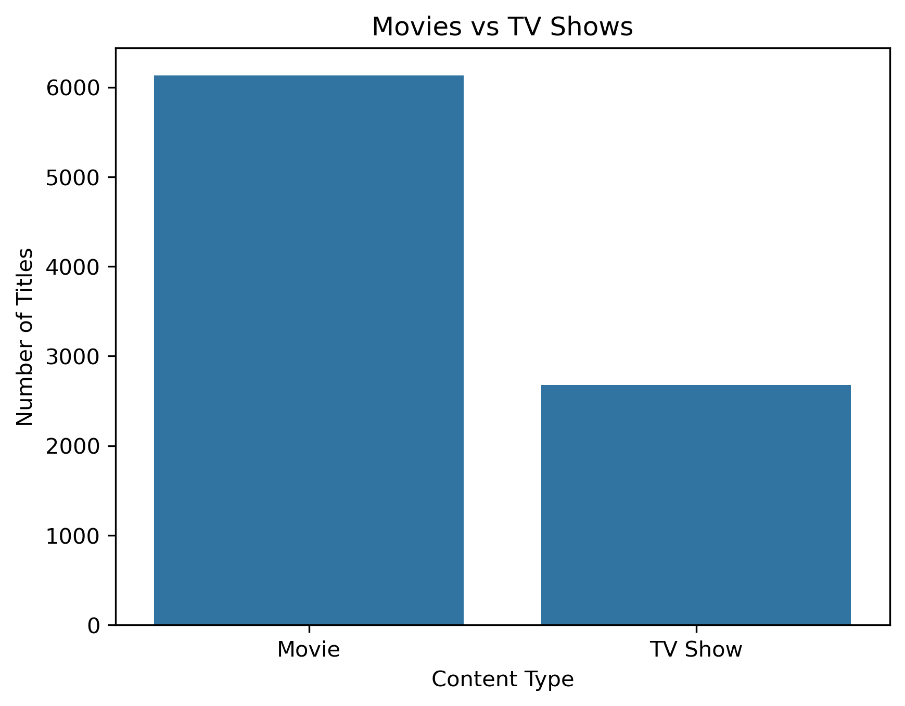
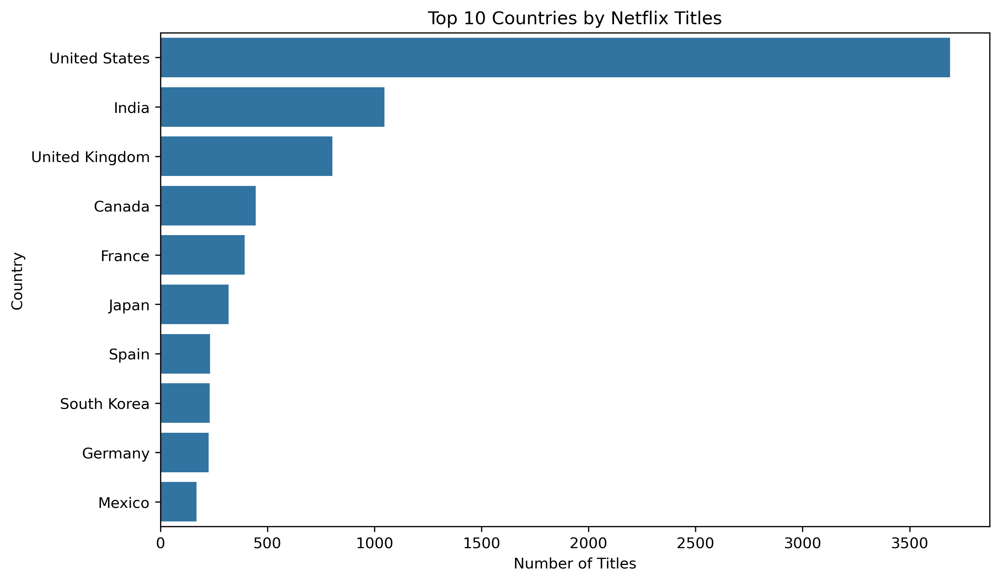
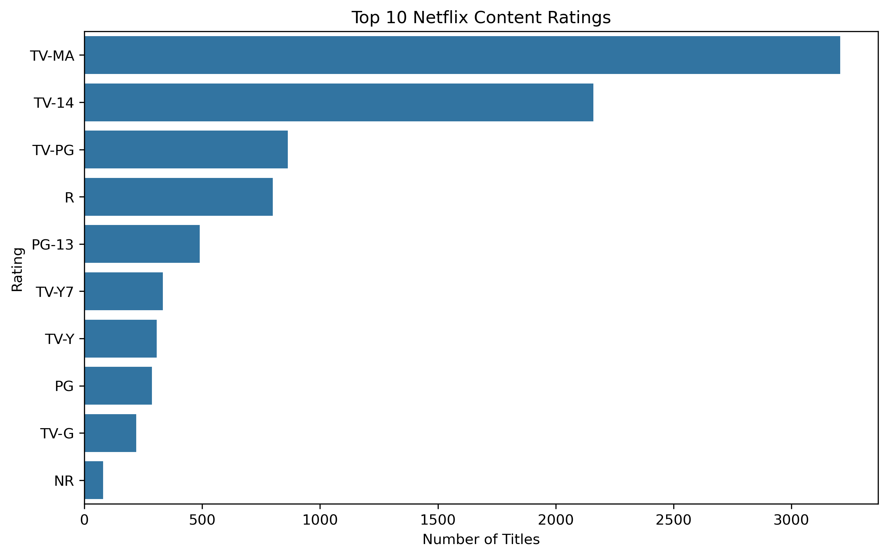
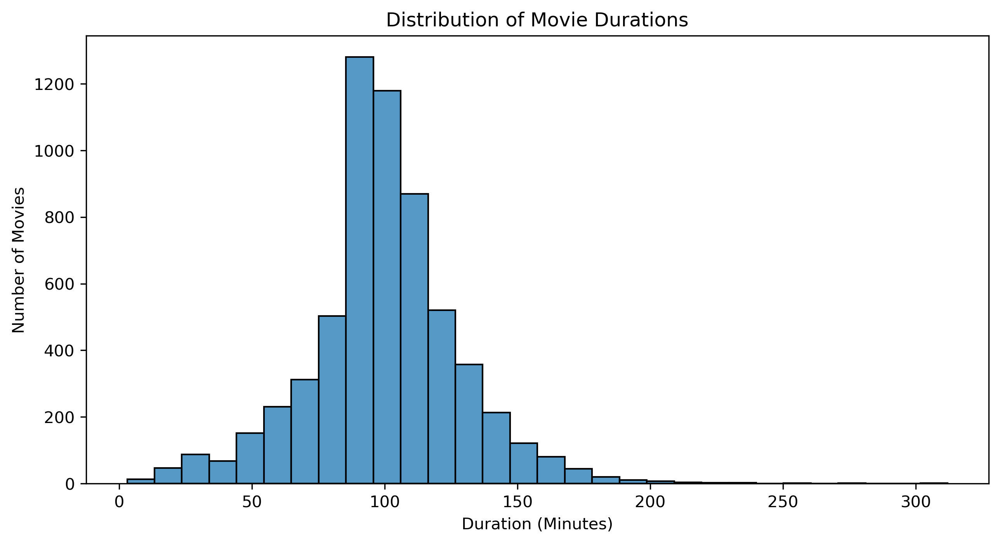
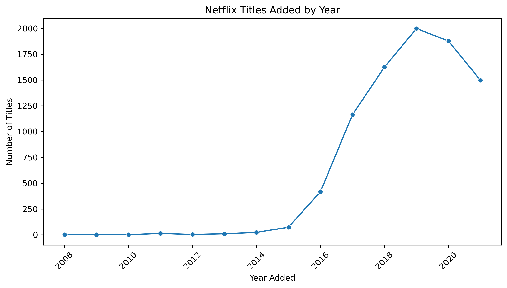

# Netflix Data Analytics Project

## Project Overview
This project explores the Netflix titles dataset using Python and data analysis libraries.

## Tools and Technologies
- Python
- Pandas
- NumPy
- Matplotlib
- Seaborn
- Jupyter Notebook

## Analysis Performed
- Data cleaning and missing value handling
- Movies vs TV Shows analysis
- Release year trends
- Country-wise content analysis
- Content ratings and genre analysis
- Movie duration and TV Show seasons analysis

## Key Findings
- Movies account for approximately 69.6% of titles.
- The United States has the highest number of titles in the dataset.
- 2019 had the highest number of titles added, with 1,999 titles.
- July had the highest number of titles added by month.
- TV-MA was the most common rating for Movies and TV Shows.
- The average movie duration was approximately 99.6 minutes.
- Most TV Shows had one season.

## Visualizations

### Movies vs TV Shows

### Top 10 Countries

### Content Ratings

### Movie Duration Distribution

### Titles Added by Year

## Project Structure
- `dataset/` — Dataset files
- `notebooks/` — Jupyter Notebook
- `sql/` — SQL analysis files
- `visualizations/` — Graphs and charts

## Note
All findings are based on the dataset used in this project and do not represent Netflix's current live catalog.
